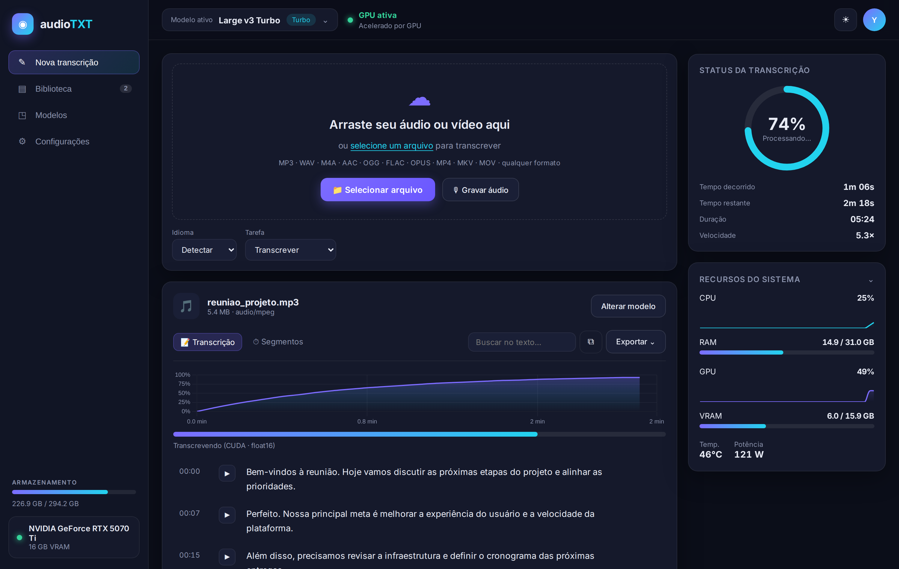
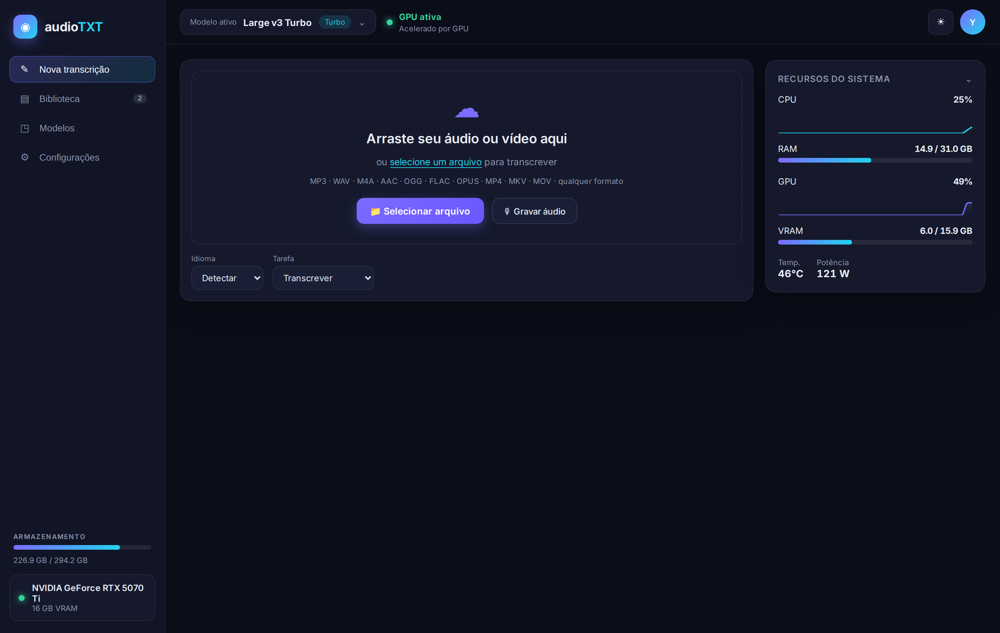
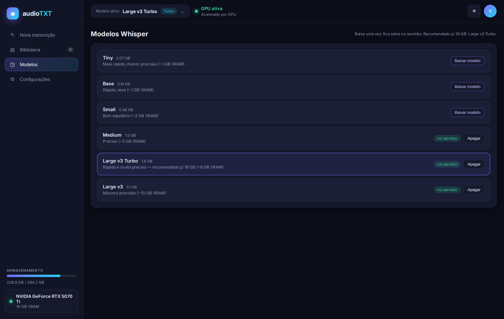
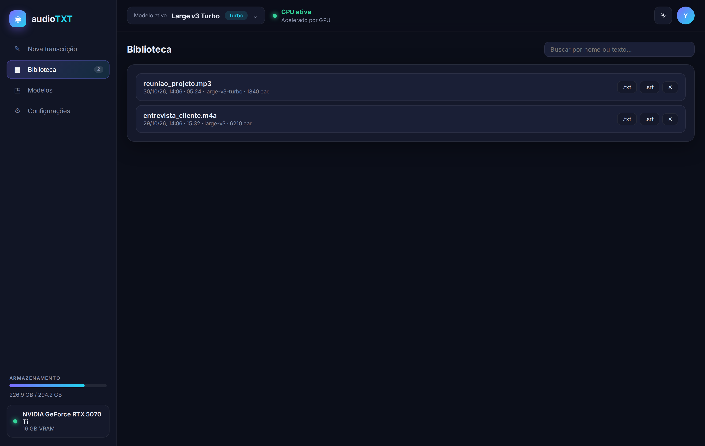
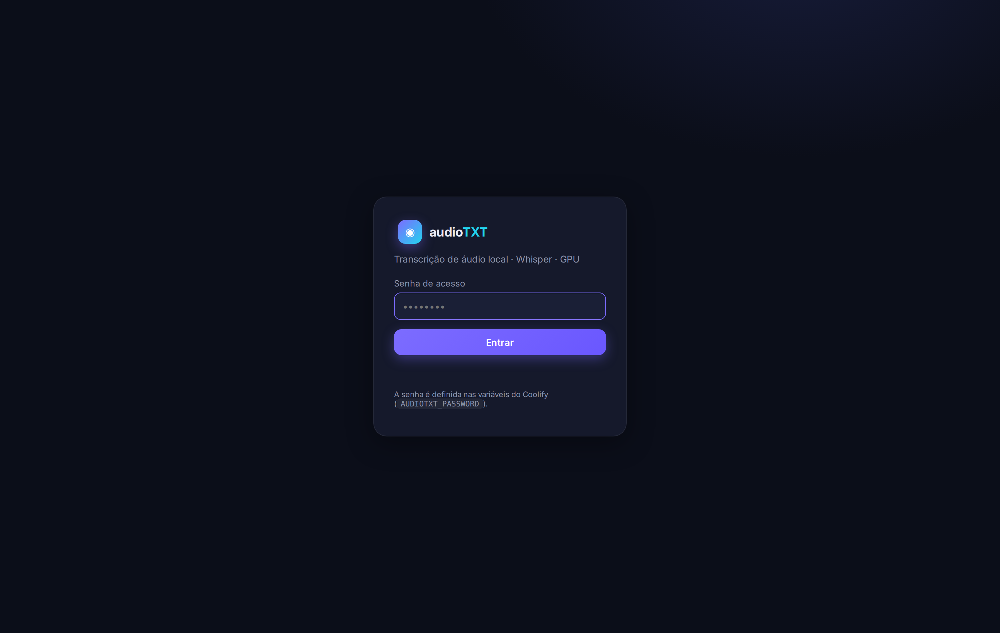

<div align="center">

# 🎙️ audioTXT

**Transcrição de áudio e vídeo 100% local, acelerada por GPU, com um painel web premium.**

Whisper (via [faster-whisper](https://github.com/SYSTRAN/faster-whisper) / CTranslate2) rodando na sua própria placa — sem enviar nada para a nuvem. Baixe o modelo pela tela, suba o áudio e acompanhe a transcrição ao vivo, com player, waveform, histórico e gráficos de GPU/CPU em tempo real.



</div>

---

## ✨ Destaques

- **100% local e privado** — o áudio é processado na sua máquina/servidor e **apagado após a transcrição**; ficam apenas o texto e os arquivos gerados.
- **Acelerado por GPU** (CUDA/float16) com **fallback automático para CPU** se a GPU não estiver disponível.
- **Baixe modelos pela interface** — do `tiny` ao `large-v3`, incluindo o **Large v3 Turbo** (recomendado para placas de 16 GB: rápido e muito preciso). Baixar, cancelar e apagar, tudo pela tela.
- **Qualquer formato** de áudio ou vídeo (mp3, wav, m4a, aac, ogg, flac, opus, aiff, mp4, mkv, mov…).
- **Transcrição ao vivo**, trecho a trecho, com **gráfico de progresso no tempo**, barra, tempo decorrido, **tempo restante estimado**, duração e velocidade (× tempo real).
- **Roda em segundo plano no servidor**: recarregou a página ou fechou a aba? Ao voltar, a transcrição **reconecta sozinha** e continua de onde estava.
- **Upload em pedaços (chunked)** — envia arquivos grandes (1 GB+) mesmo atrás de um proxy/Cloudflare que limita o tamanho das requisições, com progresso real.
- **Extrair só o áudio no navegador** antes de enviar — converte vídeos / áudios pesados para 16 kHz mono *antes* do upload (ex.: um vídeo de 1 GB vira poucos MB). Aparece só quando realmente ajuda.
- **Editor de transcrição** com timestamps, **player com waveform** sincronizado, busca com destaque, edição do texto, cópia e **exportação `.txt` / `.srt`**.
- **Biblioteca** com histórico persistente: reabrir, rebaixar `.txt`/`.srt` e apagar.
- **Painel técnico** recolhível com CPU, RAM, GPU, VRAM, temperatura, potência (via NVML) e armazenamento — tudo real.
- **Gravação pelo microfone** direto no navegador.
- Tema **claro/escuro**, responsivo (desktop, tablet e celular) e login por senha.

## 📸 Telas

| Nova transcrição | Modelos |
|---|---|
|  |  |

| Biblioteca | Login |
|---|---|
|  |  |

## 🧱 Arquitetura

- **Backend:** [FastAPI](https://fastapi.tiangolo.com/) + [faster-whisper](https://github.com/SYSTRAN/faster-whisper) (CTranslate2). Decodificação de áudio via **ffmpeg** (aceita qualquer formato). Métricas via `nvidia-ml-py` (NVML) e `psutil`.
- **Frontend:** HTML/CSS/JS puro, sem build. [Chart.js](https://www.chartjs.org/) para os gráficos, SSE para progresso ao vivo, Web Audio API para a waveform e para extrair o áudio no navegador.
- **Imagem:** `nvidia/cuda:12.8.0-cudnn-runtime-ubuntu22.04` — compatível com GPUs Blackwell (ex.: RTX 5070 Ti) e com os requisitos CUDA 12 + cuDNN 9 do CTranslate2.
- **Persistência:** modelos e resultados ficam no volume `audiotxt_data` (`/data`).

```
app/
  main.py          # FastAPI: auth, upload (chunked), jobs em 2º plano, SSE, histórico, métricas
  transcriber.py   # faster-whisper: catálogo/download de modelos, GPU→CPU, geração de segmentos
  metrics.py       # CPU/RAM/GPU/VRAM/disco (psutil + NVML)
web/
  index.html · app.css · app.js   # painel (sem build)
  login.html
Dockerfile · docker-compose.yml · dynamic-proxy.yaml
```

### Como funciona a transcrição
1. O arquivo é enviado em **pedaços de 16 MB** e remontado no servidor.
2. Um **worker em segundo plano** carrega o modelo (GPU→CPU), decodifica o áudio com ffmpeg para 16 kHz mono e transcreve.
3. Cada trecho é transmitido por **SSE**; o navegador pode desconectar e reconectar a qualquer momento.
4. No fim, gera `.txt` e `.srt`, registra no histórico e **apaga o áudio** enviado.

## 🚀 Deploy (Coolify + Traefik)

O app foi feito para rodar atrás do Traefik, no mesmo padrão dos demais serviços de um servidor Coolify.

1. **Variáveis de ambiente** (veja [`.env.example`](.env.example)). No mínimo:
   ```env
   AUDIOTXT_PASSWORD=<sua senha de acesso>
   AUDIOTXT_SESSION_SECRET=<openssl rand -hex 32>
   ```
2. **Recurso "Docker Compose Empty"** no Coolify → cole o [`docker-compose.yml`](docker-compose.yml) (o build usa a GPU via `nvidia-container-toolkit`).
3. **Rota do Traefik:** copie o [`dynamic-proxy.yaml`](dynamic-proxy.yaml) para `/data/coolify/proxy/dynamic/` (ajuste o `Host(...)` para o seu domínio).
4. **Deploy.** No primeiro acesso, baixe um modelo na aba **Modelos** e comece a transcrever.

> **Requisitos:** GPU NVIDIA com driver recente + `nvidia-container-toolkit` no host. Sem GPU, o app roda em CPU automaticamente (mais lento).

### Rodar localmente

```bash
cp .env.example .env            # defina AUDIOTXT_PASSWORD e AUDIOTXT_SESSION_SECRET
docker compose up --build       # http://localhost:8000  (use AUDIOTXT_COOKIE_SECURE=false em http)
```

## ⚙️ Variáveis

| Variável | Padrão | Descrição |
|---|---|---|
| `AUDIOTXT_PASSWORD` | — | Senha de acesso à página. Vazio = sem senha. |
| `AUDIOTXT_SESSION_SECRET` | aleatório | Assina o cookie de sessão. |
| `AUDIOTXT_SESSION_HOURS` | `72` | Validade da sessão. |
| `AUDIOTXT_COOKIE_SECURE` | `true` | Cookie só em HTTPS (use `false` em local). |
| `AUDIOTXT_DEFAULT_MODEL` | `large-v3-turbo` | Modelo pré-selecionado. |
| `AUDIOTXT_DEVICE` | `auto` | `auto` (GPU→CPU) ou `cpu`. |

## 🔒 Privacidade

O áudio enviado é apagado assim que a transcrição termina (ou falha). Não há telemetria, nem envio para serviços externos — tudo acontece no seu servidor.

## 📄 Licença

MIT — veja [`LICENSE`](LICENSE).

---

<div align="center">
Feito para rodar na sua própria GPU. 🚀
</div>
